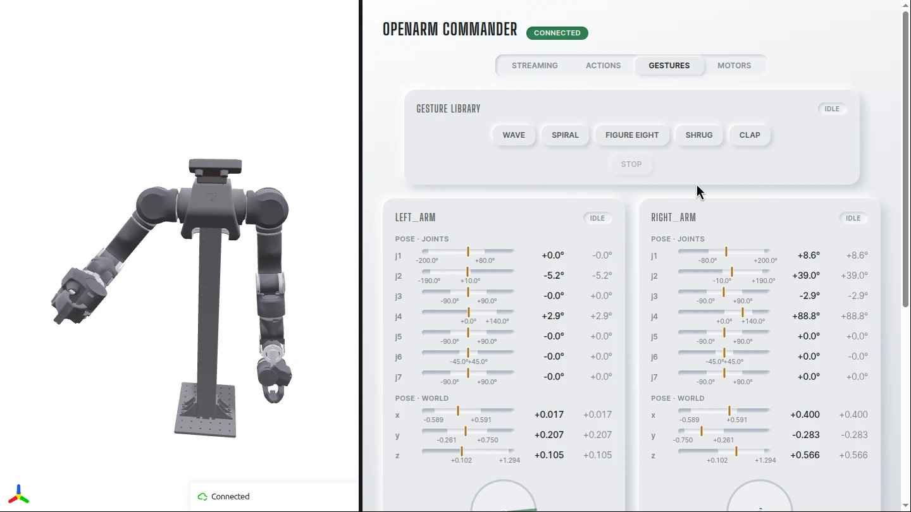

import { Steps } from '@astrojs/starlight/components';
import OpenArmStackGraph from '../../components/OpenArmStackGraph.astro';
import YouTubeEmbed from '../../components/YouTubeEmbed.astro';
import conceptsVideo from '../../../concepts_video/upload.json';

Three steps take you from nothing installed to a bimanual [OpenArm](https://openarm.dev/) you can drive from your browser. There is no repository to clone and no robot hardware to plug in: the arms, the grippers, and the physics all run in a MuJoCo simulation on your machine.

This page is a demo, not a tutorial. It exists so you can watch a peppy stack work end to end before you learn how one is put together. To learn how one is put together, start at [Installation](/guides/installation/) and work through the [guides](/guides/first_node/), which build a stack up node by node from an empty directory.

Peppy runs on Ubuntu 24.04 or later and the Linux distributions built on it, on Debian 13 or later (x86_64/aarch64, tested on Ubuntu 24.04), on Raspberry Pi OS (64-bit, based on Debian 13 or later), and on macOS (Apple Silicon). Of the Raspberry Pi boards, it runs on the Raspberry Pi 5, the Pi 500 and the Compute Module 5. Other Linux distributions, Fedora and Arch Linux among them, are not supported, and neither are Ubuntu 22.04, Debian 12, 32-bit systems and the older Raspberry Pi boards: the installer stops on them before it changes anything.

## Step 1: Install peppy

<Steps>
1. Run the installer:

   ```sh
   curl -fsSL https://peppy.bot/install.sh | sh
   ```

   It drops the `peppy` CLI on your `PATH`, registers the background service that builds and supervises nodes, and configures the [Apptainer](https://apptainer.org/) container runtime the simulation nodes are built on.

2. Confirm the CLI and the service are both there:

   ```sh
   peppy info
   ```

   It prints the CLI version and container setup, then a `Daemon Info` block. That block is the background service answering, so seeing it means everything is up.

   To read just the CLI version without contacting the daemon, run `peppy --version` (or `-V`); it prints the version alone from the binary itself.

   If your shell reports `peppy: command not found`, apply the `PATH` update the installer printed (`source ~/.bashrc`, or whichever file it named) and run it again. Shells opened afterwards pick it up on their own.
</Steps>

[Installation](/guides/installation/) covers version pinning, skipping the service, and managing it afterwards.

## Step 2: Launch the simulated robot

A launcher is a single file that lists every node in a robot stack. Parts that vary (such as the simulator or control interface) are selected at launch time with `--with`.

The installer indexes the default `launchers-hub` repository, so you can launch [`openarm_simulation`](https://github.com/Peppy-bot/launchers-hub/blob/main/openarm/openarm_simulation.json5) by name and select MuJoCo as its simulator. By default, this launcher deploys one simulated OpenArm v2 named `alpha` with the browser control panel:

```sh
peppy stack launch openarm_simulation --with mujoco
```

This single command adds, builds, and starts four node instances in dependency order:

- **MuJoCo simulation**: runs the physics and renders the simulated world.
- **Robot initializer**: spawns the OpenArm v2 model in the simulation and signals ready once all limbs are loaded.
- **Backbone**: coordinates both arms and pairs each arm and gripper with the simulation.
- **Browser control panel**: serves the web UI to drive the robot.

`alpha` is the name of this robot copy and prefixes its instance IDs (for example, `alpha_backbone_inst`). When the stack is ready, the command prints `Launch complete` and returns. Replacing the stack is the default behavior of `launch`; use `peppy stack join` later to add more [copies](/guides/launch_files/#copies) to the running stack.

The nodes keep running under the Peppy background service, so you can close this terminal without stopping them.

:::note[This is the node stack you just launched]
Each circle is a running instance and each arrow is a connection between two instances. Together they form the [node stack](/reference/concepts/#node-stack): the set of nodes managed by the background service. Run `peppy stack list` to see the same graph as tables.

<OpenArmStackGraph />
:::

:::note
The first launch downloads the MuJoCo container image (a few hundred megabytes) and converts it into a local Apptainer image, so it takes a few minutes. Later launches reuse the cached image.

Download progress, disk writes, CPU usage, and Cargo progress all reset the build idle timer, so a slow network or long compile will not time out on its own. If a custom build legitimately goes quiet for several minutes (no output, no disk writes, and no CPU usage), raise the limit with `--node-build-idle-timeout-secs`.
:::

## Step 3: Drive the arms

The launch ends with the pages the stack serves, under `Web pages:`, one URL per address of the machine:

```
Web pages:
  alpha_commander_inst (openarm_web_commander:v1) @cn-sweet-edison
    panel   http://127.0.0.1:8765
            http://100.123.58.116:8765
  simulation_inst (sim_mujoco:v1) @cn-sweet-edison
    viewer  http://127.0.0.1:23818
            http://100.123.58.116:23818
```

Open both pages, each in a browser tab:

| Page | Address | What it is |
|---|---|---|
| `viewer` | **http://localhost:23818** | the MuJoCo viewer, showing both arms in the simulated world |
| `panel` | **http://localhost:8765** | the `openarm_web_commander` control panel |

Put them side by side. The panel opens in **Streaming** mode, with a card per arm: press **Enable** on one, drag any of its joint sliders or its gripper slider, and that side follows your input live in the viewer. The mode switch has three more modes to try once the arms move: **Actions** for one governed move to a target you compose, **Gestures** for a baked choreography, and **Motors** for a read-only view of every motor's health.

A gesture needs no **Enable**: open **Gestures** and click **Wave**. The robot raises its right arm and waves, and the gesture library shows the progress of the gesture until it is idle again.



To shut things down, stop instances one at a time:

```sh
peppy node stop alpha_commander_inst
```

Or tear the whole stack down at once, which stops every instance and empties the stack:

```sh
peppy stack reset
```

<details>
<summary>**If something doesn't come up**</summary>

**The viewer or the panel won't load.** The simulation keeps initializing for a moment after `Launch complete`. Give it a few seconds, then run `peppy stack list`: every instance should read `running` under `STATUS` and `healthy` under `HEALTH`. To dig into one of them:

```sh
peppy node info sim_mujoco:v1
```

It prints the instance's state and health plus the path to its run log, which is the file to read when the state alone doesn't explain the problem.

**The panel won't load and `alpha_commander_inst` is not running.** Port 8765 is taken, usually by an earlier instance that is still up. Find it with `peppy stack list` and stop it with `peppy node stop <instance_id>`, then launch again.

**The viewer isn't on 23818.** Something else holds that port, so the sim took one the operating system picked. The `viewer` lines under `Web pages:` are the addresses it serves, and `peppy node info sim_mujoco:v1` lists them again. To pin a port, set `viewer_port` in the sim instance's `arguments` (flatten the launcher to a file with `peppy stack resolve openarm_simulation --with mujoco`, edit it, and launch the file).

**A build fails on Linux.** Apptainer needs packages of the distribution and unprivileged user namespaces, which the installer normally configures. Check with `peppy container status`, and repair it with `peppy container setup` (see [Containers](/advanced_guides/containers/)).

**The launch fails with `Dependencies missing from nodes cache` or `nodes.json5 not found or empty`.** The local index is stale or was never populated. Run `peppy repo refresh` and launch again.

</details>

## The concepts of Peppy

This ten-minute video explains the stack you just launched: what a node is and how one file declares it, how nodes form a stack, what contracts and launchers are for, and how the same stack goes from a simulation to a real robot, on one machine or on several. [Concepts](/reference/concepts/) defines the same terms in writing.

<YouTubeEmbed id={conceptsVideo.youtube_id} title="The concepts of Peppy" />

## Where to go next

You just ran a stack someone else assembled. To build your own:

- [Installation](/guides/installation/): the full install reference, including service management
- [Creating your first node](/guides/first_node/): write and run a node from scratch, in Rust or Python
- [Launch files](/guides/launch_files/): the launcher format behind the command you just ran
- [Repositories](/advanced_guides/repositories/): where peppy resolves node and launcher names from, and how to add your own
- [Concepts](/reference/concepts/): nodes, instances, contracts, and the stack, defined
